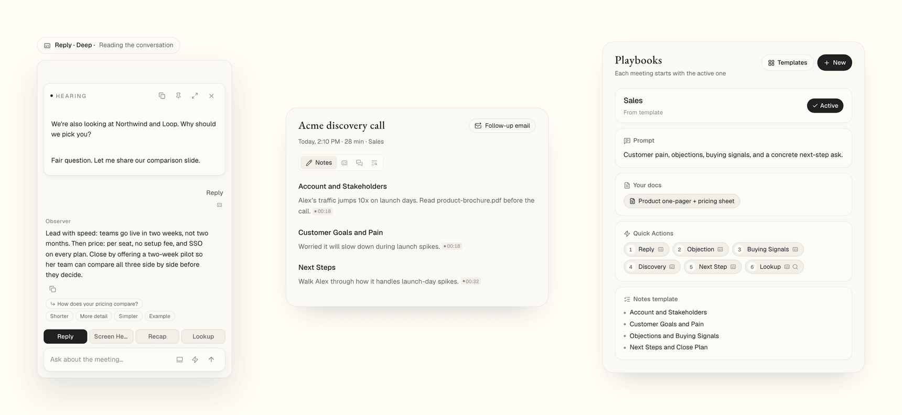

<a href="https://getobserver.app">
  <picture>
    <source media="(prefers-color-scheme: dark)" srcset="https://raw.githubusercontent.com/getobserver/.github/main/profile/assets/logo-dark.svg">
    
  </picture>
</a>

<h1>Observer</h1>

<b>Your AI companion for every meeting.</b> 
Answers while they are still talking, notes the moment the call ends. 
Hidden from screen share. No bot joins. Mac and Windows.

  

## What it does

**Observer** is the AI companion for meetings from [getobserver.app](https://getobserver.app), a desktop app that works as a real-time meeting assistant. It runs on your computer, so no bot joins the call.

- **[Live answers](https://getobserver.app/help/quick-actions).** Press one key for a reply, a recap, a fact check or help with your screen.
- **[Auto-answer](https://getobserver.app/help/auto-answer).** Observer replies as soon as someone finishes a question.
- **[Undetectable](https://getobserver.app/undetectability).** Hidden from screen shares and recordings, and it doesn't take focus from your window.
- **[Notes after every call](https://getobserver.app/help/meeting-notes-transcripts-conversations).** Notes from your template, the transcript, a follow-up email draft, and Ask for questions about the meeting.
- **[Playbooks](https://getobserver.app/help/playbooks).** Set up each kind of meeting with a prompt, your PDFs, Quick Actions and a notes template. Seven come built in; more are in our free, optional [Playbook library](https://github.com/getobserver/playbooks).
- **[Any meeting app](https://getobserver.app/help/supported-meeting-apps).** Zoom, Google Meet, Microsoft Teams, Slack, Webex, Discord and browser-based calls.

<b>Playbook templates</b>

 

| Template | For | Quick Actions |
|---|---|---|
| **Sales** | Objections, discovery and next-step asks | Reply · Objection · Buying Signals · Discovery · Next Step · Lookup |
| **Interview** | Keep your resume and the job description in context | Reply · Behavioral · Ask Them · Lookup |
| **Recruiting** | Evaluate candidates against the role | Verify Claim · Check Answer · Follow Up · Hiring Risk · Candidate Summary · Lookup |
| **Technical Discussion** | Debug, compare tradeoffs, capture decisions | Debug Screen · Explain Topic · Tradeoffs · Clarify · Decisions · Lookup |
| **Team Meeting** | Decisions, blockers, owners and action items | Decisions · Action Items · Blockers · Recap · Clarify · Lookup |
| **Lecture** | Turn live teaching into study notes | Explain Concept · Example · Segment Recap · Study List · Check Me · Lookup |
| **General** | Any other conversation | Reply · Screen Help · Recap · Lookup |

<b>Keyboard shortcuts</b>

 

| Action | Mac | Windows |
|---|---|---|
| Quick Action 1 to 0 | <kbd>⌥</kbd> <kbd>1</kbd> … <kbd>0</kbd> | <kbd>Alt</kbd> <kbd>1</kbd> … <kbd>0</kbd> |
| Deep answer | <kbd>⌥</kbd> <kbd>⇧</kbd> <kbd>1</kbd> | <kbd>Alt</kbd> <kbd>Shift</kbd> <kbd>1</kbd> |
| Screen analysis | <kbd>⌘</kbd> <kbd>↵</kbd> | <kbd>Ctrl</kbd> <kbd>Enter</kbd> |
| Compact or expand | <kbd>⌘</kbd> <kbd>⌥</kbd> <kbd>M</kbd> | <kbd>Ctrl</kbd> <kbd>Alt</kbd> <kbd>M</kbd> |
| Show or hide transcript | <kbd>⌘</kbd> <kbd>T</kbd> | <kbd>Ctrl</kbd> <kbd>T</kbd> |
| Clear chat | <kbd>⌘</kbd> <kbd>K</kbd> | <kbd>Ctrl</kbd> <kbd>K</kbd> |
| Snap left · center · right | <kbd>⌘</kbd> <kbd>⇧</kbd> <kbd>L</kbd> · <kbd>C</kbd> · <kbd>R</kbd> | <kbd>Ctrl</kbd> <kbd>Shift</kbd> <kbd>L</kbd> · <kbd>C</kbd> · <kbd>R</kbd> |

<b>Privacy and security</b>

 

- **Your account only.** Meetings, transcripts, notes and AI chat are tied to your sign-in; other users can't read them.
- **No audio recordings kept.** Audio is transcribed in real time; what's saved is the transcript, notes and chat.
- **No training on your content.** Speech and AI providers work under contracts that prohibit it.
- **Delete anytime.** Remove a meeting in the app or delete your whole account from Profile.
- **Undetectable is off by default.** It keeps your notes out of what you present, not a way around the rules of a meeting, assessment or platform ([Acceptable Use](https://getobserver.app/terms#acceptable-use)).

[Security](https://getobserver.app/security) · [What Observer stores](https://getobserver.app/help/how-observer-stores-meeting-data) · [Subprocessors](https://getobserver.app/subprocessors) · [Privacy](https://getobserver.app/privacy-policy) · [Terms](https://getobserver.app/terms)

<b>Compare Observer</b>

 

[vs Cluely](https://getobserver.app/compare/observer-vs-cluely) · [vs Parakeet AI](https://getobserver.app/compare/observer-vs-parakeet-ai) · [vs Otter](https://getobserver.app/compare/observer-vs-otter) · [vs Granola](https://getobserver.app/compare/observer-vs-granola) · [vs Littlebird](https://getobserver.app/compare/observer-vs-littlebird) · [vs ChatGPT](https://getobserver.app/compare/observer-vs-chatgpt) · [vs Claude](https://getobserver.app/compare/observer-vs-claude) · [Cluely alternatives](https://getobserver.app/compare/cluely-alternatives)

## Get started

[Download](https://getobserver.app/download) for macOS 13+ or Windows 10+ (64-bit), sign in, pick a Playbook and [start your first meeting](https://getobserver.app/help/start-your-first-meeting). Free trial, no credit card needed.

[Pricing](https://getobserver.app/pricing) · [Teams](https://getobserver.app/help/observer-for-teams) · [Use cases](https://getobserver.app/use-cases) · [Help Center](https://getobserver.app/help) · [Book a demo](https://cal.com/rohit-observer/30min) · [hello@getobserver.app](mailto:hello@getobserver.app)

**Follow:** [X](https://x.com/getobserver) · [LinkedIn](https://www.linkedin.com/company/getobserver) · [Instagram](https://www.instagram.com/getobserver/) · [TikTok](https://www.tiktok.com/@getobserver) · [Discord](https://discord.gg/sqZk8mHTzX) · [Product Hunt](https://www.producthunt.com/products/observer-4) · [Peerlist](https://peerlist.io/company/getobserver) · [Indie Hackers](https://www.indiehackers.com/product/observer-2)

Built by [Rohit Malhotra](https://www.linkedin.com/in/rohitmalhotra1420/). Observer (getobserver.app) is not related to Observe.AI (contact-center software) or Observer AI (observer-ai.com, open-source screen-monitoring agents).
