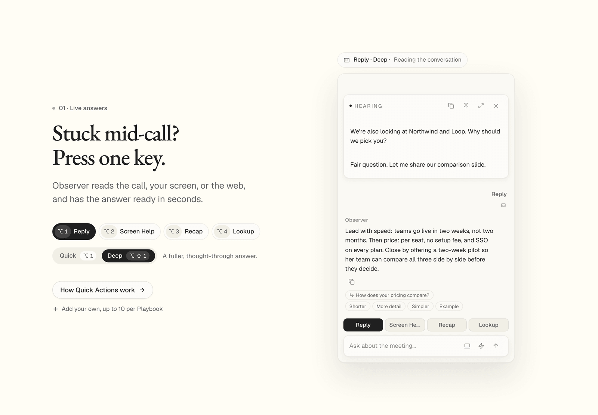
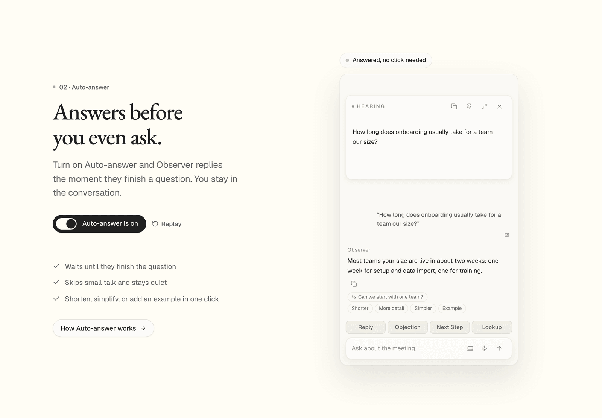
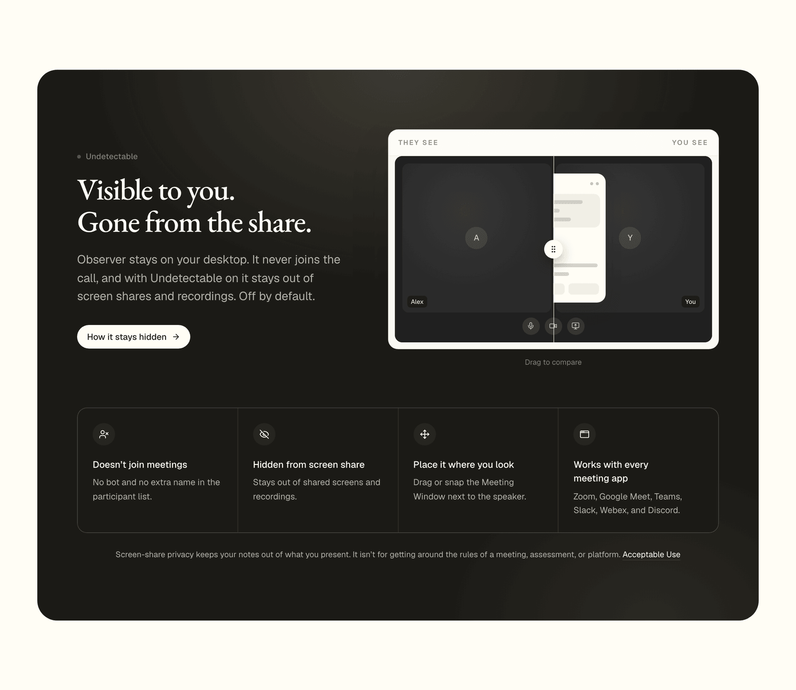
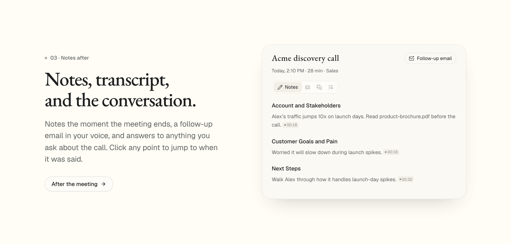
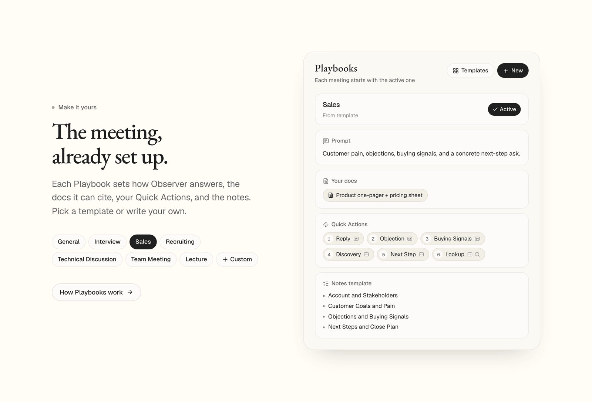

<a href="https://getobserver.app">
  <picture>
    <source media="(prefers-color-scheme: dark)" srcset="https://raw.githubusercontent.com/getobserver/.github/main/profile/assets/logo-dark.svg">
    
  </picture>
</a>

<h1>Observer</h1>

<h3>Your AI companion for every meeting</h3>

Answers while they are still talking, from the call, your screen, and the web. 
Notes the moment the meeting ends. Hidden from screen share. No bot joins.

  

<a href="https://getobserver.app"><b>Website</b></a> ·
<a href="https://getobserver.app/download"><b>Download</b></a> ·
<a href="https://getobserver.app/how-it-works"><b>How it works</b></a> ·
<a href="https://getobserver.app/use-cases"><b>Use cases</b></a> ·
<a href="https://getobserver.app/pricing"><b>Pricing</b></a> ·
<a href="https://getobserver.app/help"><b>Help Center</b></a> ·
<a href="https://getobserver.app/compare"><b>Compare</b></a>

---

## What is Observer?

**Observer** is the AI companion for meetings from [getobserver.app](https://getobserver.app): a desktop app for Mac and Windows that works as a real-time meeting assistant. It listens to your call, reads your screen when you ask, and gives you the answer while people are still talking. When the call ends, it writes your notes, keeps the transcript, and drafts the follow-up email.

It never joins the meeting as a bot, and with Undetectable on, its window stays out of screen shares and recordings.

| Why Observer | What you get |
|---|---|
| **No meeting bot** | Runs on your computer. No extra name in the participant list. |
| **Live answers** | One key gives you a reply, a recap, a fact check or help with your screen. |
| **Auto-answer** | Replies the moment someone finishes a question, without a click. |
| **Undetectable** | Hidden from screen shares and recordings, and it doesn't take focus from the window you're in. |
| **Notes after every call** | Notes from your template, the transcript, the AI chat and a follow-up email draft. |
| **Playbooks** | A setup per kind of meeting: prompt, your PDFs, Quick Actions and a notes template. |
| **Any meeting app** | Zoom, Google Meet, Microsoft Teams, Slack, Webex, Discord and browser-based calls. |

---

## Live answers: stuck mid-call? Press one key.

Quick Actions read the call, your screen or the web and have the answer ready in seconds. Use a quick answer, or a deep one when you need more. Every answer can be made **shorter**, **more detailed**, **simpler**, or turned into an **example**.

## Auto-answer: answers before you even ask

Turn on Auto-answer and Observer replies as soon as they finish a question. It waits for the end of the question, skips small talk, and stays quiet otherwise.

## Undetectable: visible to you, gone from the share

Observer stays on your desktop. With Undetectable on, its window is left out of screen shares and recordings. It's off by default, and it's for keeping your notes out of what you present, not for getting around the rules of a meeting, assessment or platform ([Acceptable Use](https://getobserver.app/terms#acceptable-use)).

## Notes, transcript, and the conversation

Notes are ready the moment the meeting ends, written to your Playbook's headings, with every point linked to the moment it was said. You also get a follow-up email in your voice, the full transcript, and **Ask** for questions about the meeting. Send notes to Notion if you like.

## Playbooks: the meeting, already set up

Each Playbook sets how Observer answers, the documents it can cite, your Quick Actions, and the notes template. Start from a template or write your own.

| Template | For | Quick Actions |
|---|---|---|
| **Sales** | Objections, discovery and next-step asks | Reply · Objection · Buying Signals · Discovery · Next Step · Lookup |
| **Interview** | Keep your resume and the job description in context | Reply · Behavioral · Ask Them · Lookup |
| **Recruiting** | Evaluate candidates against the role | Verify Claim · Check Answer · Follow Up · Hiring Risk · Candidate Summary · Lookup |
| **Technical Discussion** | Debug, compare tradeoffs, capture decisions | Debug Screen · Explain Topic · Tradeoffs · Clarify · Decisions · Lookup |
| **Team Meeting** | Decisions, blockers, owners and action items | Decisions · Action Items · Blockers · Recap · Clarify · Lookup |
| **Lecture** | Turn live teaching into study notes | Explain Concept · Example · Segment Recap · Study List · Check Me · Lookup |
| **General** | Any other conversation | Reply · Screen Help · Recap · Lookup |

<b>Keyboard shortcuts</b>

 

| Action | Mac | Windows |
|---|---|---|
| Quick Action 1 to 0 | <kbd>⌥</kbd> <kbd>1</kbd> … <kbd>0</kbd> | <kbd>Alt</kbd> <kbd>1</kbd> … <kbd>0</kbd> |
| Deep answer | <kbd>⌥</kbd> <kbd>⇧</kbd> <kbd>1</kbd> | <kbd>Alt</kbd> <kbd>Shift</kbd> <kbd>1</kbd> |
| Screen analysis | <kbd>⌘</kbd> <kbd>↵</kbd> | <kbd>Ctrl</kbd> <kbd>Enter</kbd> |
| Compact or expand | <kbd>⌘</kbd> <kbd>⌥</kbd> <kbd>M</kbd> | <kbd>Ctrl</kbd> <kbd>Alt</kbd> <kbd>M</kbd> |
| Show or hide transcript | <kbd>⌘</kbd> <kbd>T</kbd> | <kbd>Ctrl</kbd> <kbd>T</kbd> |
| Clear chat | <kbd>⌘</kbd> <kbd>K</kbd> | <kbd>Ctrl</kbd> <kbd>K</kbd> |
| Snap left · center · right | <kbd>⌘</kbd> <kbd>⇧</kbd> <kbd>L</kbd> · <kbd>C</kbd> · <kbd>R</kbd> | <kbd>Ctrl</kbd> <kbd>Shift</kbd> <kbd>L</kbd> · <kbd>C</kbd> · <kbd>R</kbd> |

[All shortcuts](https://getobserver.app/help/keyboard-shortcuts)

---

## Get started

1. **[Download Observer](https://getobserver.app/download)** for macOS 13 Ventura or later, or Windows 10 or later (64-bit).
2. Sign in and allow microphone and screen access ([Mac permissions](https://getobserver.app/help/macos-microphone-screen-recording-permissions)).
3. Pick a Playbook and **[start your first meeting](https://getobserver.app/help/start-your-first-meeting)**.

Free trial, no credit card needed. [See plans](https://getobserver.app/pricing) · [Observer for teams](https://getobserver.app/help/observer-for-teams) · [Book a demo](https://cal.com/rohit-observer/30min)

## Privacy and security

- **Your account only.** Meetings, transcripts, notes and AI chat are tied to your sign-in; other users can't read them.
- **No audio recordings kept.** Audio is transcribed in real time; what's saved is the transcript, notes and chat.
- **No training on your content.** Speech and AI providers work under contracts that prohibit it.
- **Delete anytime.** Remove a meeting in the app or delete your whole account from Profile.

[Security](https://getobserver.app/security) · [What Observer stores](https://getobserver.app/help/how-observer-stores-meeting-data) · [Subprocessors](https://getobserver.app/subprocessors) · [Privacy](https://getobserver.app/privacy-policy) · [Terms](https://getobserver.app/terms)

## Learn more

<table>
<tr>
<td valign="top" width="33%">

**Help Center**

- [Install on Mac](https://getobserver.app/help/install-observer-on-macos)
- [Install on Windows](https://getobserver.app/help/install-observer-on-windows)
- [How meetings work](https://getobserver.app/help/how-observer-meetings-work)
- [Quick Actions](https://getobserver.app/help/quick-actions)
- [Auto-answer](https://getobserver.app/help/auto-answer)
- [Playbooks](https://getobserver.app/help/playbooks)
- [Can others see Observer?](https://getobserver.app/help/observer-screen-share-visibility)
- [Supported meeting apps](https://getobserver.app/help/supported-meeting-apps)
- [Languages](https://getobserver.app/help/supported-languages)
- [Send notes to Notion](https://getobserver.app/help/send-notes-to-notion)

</td>
<td valign="top" width="33%">

**Compare**

- [Observer vs Cluely](https://getobserver.app/compare/observer-vs-cluely)
- [Observer vs Parakeet AI](https://getobserver.app/compare/observer-vs-parakeet-ai)
- [Observer vs Otter](https://getobserver.app/compare/observer-vs-otter)
- [Observer vs Granola](https://getobserver.app/compare/observer-vs-granola)
- [Observer vs Littlebird](https://getobserver.app/compare/observer-vs-littlebird)
- [Observer vs ChatGPT](https://getobserver.app/compare/observer-vs-chatgpt)
- [Observer vs Claude](https://getobserver.app/compare/observer-vs-claude)
- [Cluely alternatives](https://getobserver.app/compare/cluely-alternatives)

</td>
<td valign="top" width="33%">

**Observer**

- [About](https://getobserver.app/about)
- [How it works](https://getobserver.app/how-it-works)
- [Use cases](https://getobserver.app/use-cases)
- [Undetectability](https://getobserver.app/undetectability)
- [Integrations](https://getobserver.app/integrations)
- [Pricing](https://getobserver.app/pricing)
- [Community](https://getobserver.app/community)
- [Invite a friend](https://getobserver.app/help/invite-a-friend)

</td>
</tr>
</table>

## Find us

[Website](https://getobserver.app) · [X](https://x.com/getobserver) · [LinkedIn](https://www.linkedin.com/company/getobserver) · [Instagram](https://www.instagram.com/getobserver/) · [TikTok](https://www.tiktok.com/@getobserver) · [Discord](https://discord.gg/sqZk8mHTzX) · [Product Hunt](https://www.producthunt.com/products/observer-4) · [Peerlist](https://peerlist.io/company/getobserver) · [Indie Hackers](https://www.indiehackers.com/product/observer-2)

Questions: [hello@getobserver.app](mailto:hello@getobserver.app) · Built by [Rohit Malhotra](https://www.linkedin.com/in/rohitmalhotra1420/) ([X](https://x.com/itsrohitm))

Observer (getobserver.app) is not related to Observe.AI (contact-center software) or Observer AI (observer-ai.com, open-source screen-monitoring agents).
